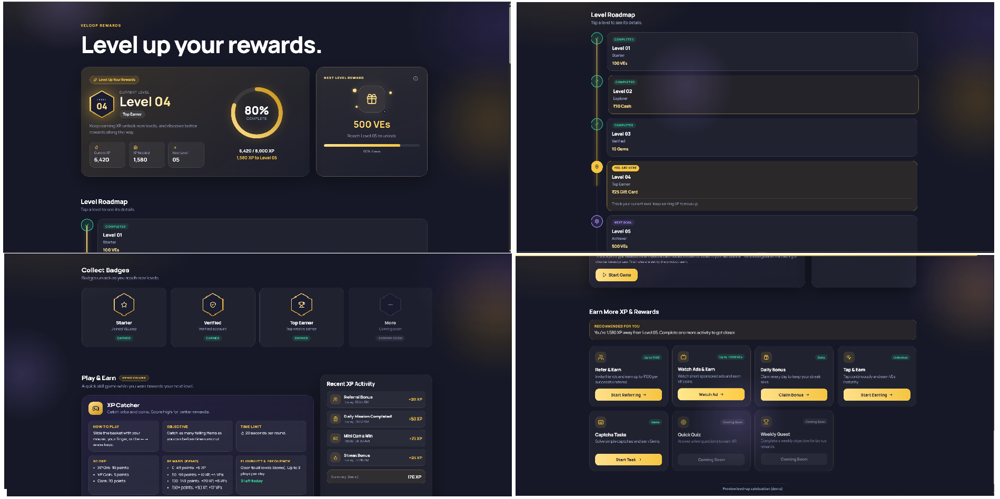
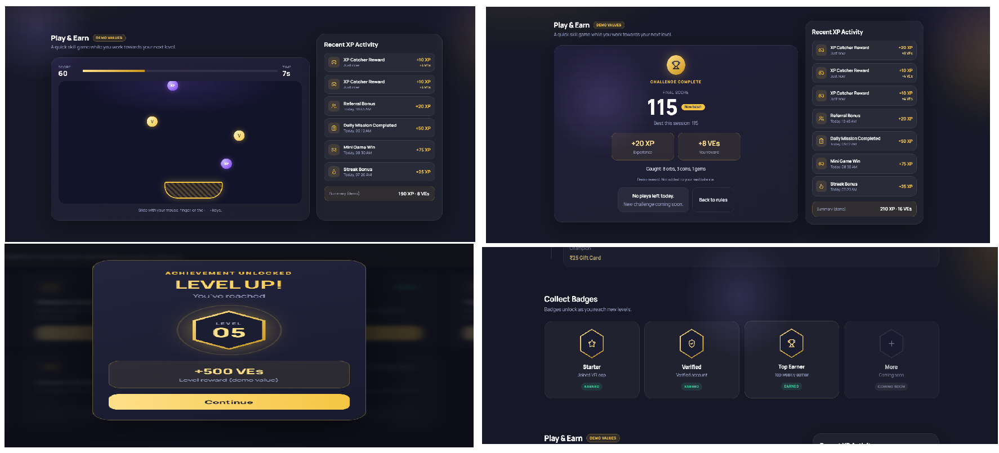

# VELoop Rewards – Level-Up Dashboard

A redesigned Level Dashboard for VELoop Rewards: a level-up, rewards, games and earning hub built with React and Vite.

**Note:** all numbers (levels, XP, rewards, game scores and XP history) are **demo values** for development. They are kept in the `src/data` folder so real backend data can replace them.

## Live Demo
https://veloop-level-dashboard-benny.vercel.app/Lvl-Dashboard

## GitHub Repository
https://github.com/kalavakollubenny20-collab/veloop-level-dashboard

## Project Overview
The page shows the user where they are, what they will unlock next, and how to get there faster:

- **Where am I?** Current level and level name
- **How far have I come?** Current XP and an animated progress ring
- **What do I need?** XP required for the next level
- **What will I get?** A locked next-level reward card
- **What can I do now?** A playable mini-game and earning activities

The loop: Play, earn XP, progress, unlock a reward, level up, return.

## Level System
- A roadmap of 7 levels with four states: **Completed**, **You Are Here**, **Next Goal** and **Locked**.
- Click a level to see its details.
- Level names, rewards and badge unlock levels are demo placeholders.

## XP System
- Current XP, XP required and XP remaining are calculated in one place (`useLevelProgress` and the page).
- XP earned in the game is added locally and moves the progress ring. It resets when the page reloads.
- A **Recent XP Activity** list shows where XP came from, with an empty state.

## Next-Level Reward
- A locked reward card shows the reward for the next level (demo: 500 VEs).
- The info icon explains that the reward follows the current reward configuration.
- When XP reaches the requirement, a **Level-Up** celebration appears. A demo button previews it.

## Game Concept: XP Catcher
A skill-based mini-game. Slide a basket to catch falling XP orbs, VE coins and gems. It is not gambling, betting or chance-based.

### Game Rules
- **Objective:** catch as many items as you can.
- **Controls:** mouse, touch, or the left and right arrow keys.
- **Time limit:** 20 seconds per round.
- **Score:** XP Orb 10, VE Coin 5, Gem 20.
- **Reward (demo):** 0–49 points = +5 XP; 50–99 = +10 XP, +4 VEs; 100–149 = +20 XP, +8 VEs; 150+ = +30 XP, +12 VEs.
- **Frequency:** up to 3 plays per day (demo limit, local only).
- **Eligibility:** open to all levels (demo).
- Rewards are **not** added to any real balance. Prototype logic is separate from future backend reward logic (`src/data/gameConfig.js`).

## Earning Features
Activities that exist on the VELoop platform today: Refer & Earn, Watch Ads & Earn, Daily Bonus, Tap & Earn and Captcha Tasks. Quick Quiz and Weekly Quest are shown as **Coming Soon** concepts. The action buttons are not yet linked to the live routes.

## Technology Stack
React, Vite, Bootstrap, CSS Modules, React Hooks, Lucide React, Framer Motion and Lenis (smooth scroll).

## Installation
```bash
git clone https://github.com/kalavakollubenny20-collab/veloop-level-dashboard.git
cd veloop-level-dashboard
npm install
```

## Development Commands
```bash
npm run dev      # start the dev server
npm run build    # create a production build
npm run preview  # preview the production build
```
Open `http://localhost:5173/Lvl-Dashboard`. To open it on a phone on the same Wi-Fi, run `npm run dev -- --host`.

## Folder Structure
```
src/
├── components/
│   ├── Badges/
│   ├── EarnMoreXP/
│   ├── LevelHero/
│   ├── LevelRoadmap/
│   ├── LevelUpModal/
│   ├── Motion/
│   ├── NextLevelReward/
│   ├── PlayAndEarn/
│   ├── Skeleton/
│   ├── XPActivity/
│   └── XPProgress/
├── data/
├── hooks/
├── pages/LevelDashboard/
└── styles/
```

## Component Architecture
- **LevelHero** and **XPProgress**: level badge, stats and the XP ring
- **NextLevelReward**: locked reward card with info tooltip
- **LevelRoadmap**: level states and details
- **Badges**: collectible badges
- **PlayAndEarn** (`GameContainer`, `GameStart`, `GamePlay`, `GameResult`): the mini-game
- **XPActivity**: recent XP history and empty state
- **EarnMoreXP**: earning cards
- **LevelUpModal**: level-up celebration
- **Skeleton**: loading state
- **Motion**: reusable animation helpers

## Responsive Behavior
Bootstrap grid and CSS Modules. Cards stack into one column on phones, and the game area and hero resize for small screens. Tested on a phone and in browser device mode.

## Animation Details
Animations are subtle and switch off when the user prefers reduced motion:
- XP ring fill and counting numbers
- Headline word reveal and scroll-in cards
- Reward card tilt and floating gift
- Roadmap line draw and pulsing current level
- Game result reveal and level-up badge reveal
- Gold dust, cursor glow and smooth scrolling

## Screenshots
### Overview



## Author
Benny Kalavakollu